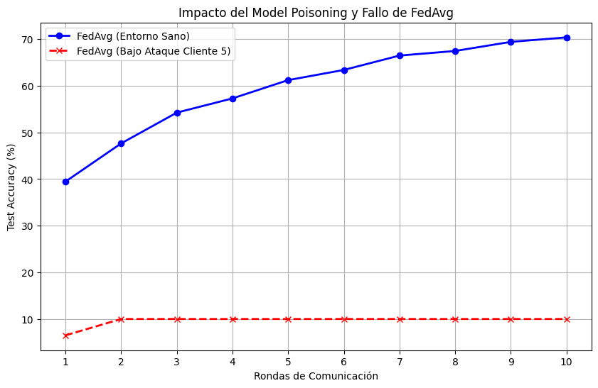
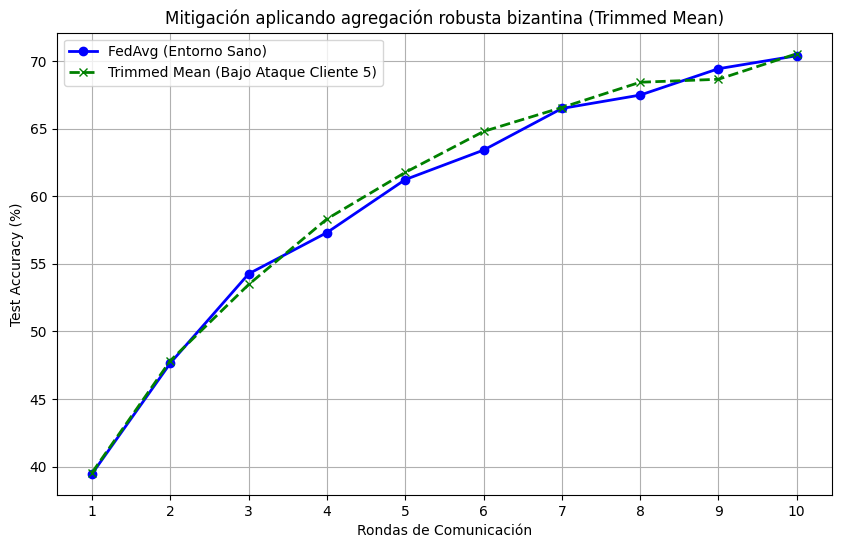

# Práctica 2. Privacidad en los Sistemas Inteligentes

**Grado en Inteligencia Artificial**  
**Autores:** a.serrano1@udc.es, oscar.vilela.rodriguez@udc.es, aldana.medina@udc.es  
**Grupo:** 1.8  

---

## 1. Anonimización de datos (10%)

### 1.1 Clasificación de atributos (Adult Census Income)

En el dataset Adult Census Income, los atributos se clasifican de la siguiente manera:
*   **Identificadores directos:** Aunque el dataset fue desprovisto de identificadores explícitos (como nombre o DNI), el atributo `fnlwgt` (final weight) podría actuar como un identificador débil dependiendo del cruce poblacional. Las técnicas más comunes para identificadores directos son la **supresión** (eliminarlos por completo) y la **pseudonimización**.
*   **Cuasi-identificadores:** Atributos como `age`, `sex` y `native_country` no identifican por sí solos, pero combinados pueden singularizar a un individuo. Para anonimizarlos se aplican técnicas de **generalización** (ej. rangos de edad, agrupación de países por continentes) y **supresión local** (sustituir el sexo por `*`).
*   **Atributo sensible:** `income` (salario `<=50K` o `>50K`). Es el atributo que se desea proteger para que no se asocie a individuos concretos.

### 1.2 Implementación de k-anonymity (k=3)
Se aplicó generalización en `age` (rangos de 10 años), generalización en `native_country` (por continentes) y supresión total en `sex` (`*`). Esta combinación permitió alcanzar $k$-anonymity ($k=3$), verificando que todos los subgrupos (clases de equivalencia) tienen al menos 3 registros. 

Anonimizar **un solo atributo** no es suficiente. Por ejemplo, al generalizar únicamente `age`, muchas combinaciones de edad generalizada junto con sexo y país específico seguían apareciendo 1 o 2 veces, incumpliendo la propiedad $k$-anonymity.

### 1.3 Ataque de Enlace (Linkage Attack)
Un atacante que posea un dataset auxiliar (`external_dataset.csv`) con identificadores reales (nombre, pasaporte) y los mismos cuasi-identificadores, puede cruzar ambos conjuntos. Si tras anonimizar el dataset externo de la misma manera el cruce devuelve registros únicos, el atacante puede asignar inequívocamente el atributo sensible (`income`) a la identidad real.

**Registros Reidentificados (Salida del Ataque):**
```text
Registros reidentificados unívocamente: 0
```

**¿Por qué falla el $k$-anonymity en este escenario?**
El $k$-anonymity falla debido a la vulnerabilidad conocida como el **Ataque de Homogeneidad**. Esta técnica de anonimización garantiza que la víctima se camufle entre un grupo de al menos $k$ personas, pero no controla el contenido de los datos sensibles de ese grupo. Si todas las personas del grupo comparten el mismo salario (homogeneidad), el atacante deduce el salario de la víctima con un 100% de certeza, inutilizando la protección del $k$-anonymity.

**¿Podría haberse evitado aplicando $l$-diversity o $t$-closeness?**
Sí. Aplicando **$l$-diversity**, forzamos a que dentro de cada grupo haya al menos $l$ valores distintos de ingresos, lo que garantiza matemáticamente que el ataque de homogeneidad fracase (el atacante ya no puede estar 100% seguro). Por otro lado, **$t$-closeness** aseguraría además que la distribución salarial del grupo se parezca a la distribución global, evitando que el atacante pueda siquiera deducir información probabilística evidente.

---

## 2. Federated Learning (50%)

### 2.1 Simulación base de Federated Learning
Se particionó CIFAR-10 en 5 clientes de forma independiente e idénticamente distribuida (IID). Se utilizó una arquitectura CNN sencilla (`SimpleCNN`). Tras 10 rondas de comunicación utilizando **FedAvg**, el modelo global convergió adecuadamente.

### 2.2 Envenenamiento del Modelo (Model Poisoning)
Se simuló un nodo malicioso en el Cliente 5, el cual aplicó dos técnicas simultáneas:
1.  **Label Flipping:** Transforma la clase $y$ en $(y + 1) \pmod{10}$.
2.  **Gradient Scaling:** Multiplica los pesos de su actualización local por un factor de 100 antes de enviarlos.

Al utilizar FedAvg, el promedio ponderado se ve drásticamente desplazado por los valores sobredimensionados del nodo malicioso. Como resultado, **el accuracy del modelo global se desplomó**, demostrando la vulnerabilidad del promediado simple frente a actualizaciones bizantinas.



### 2.3 Agregación Robusta Bizantina (Trimmed Mean)
Para mitigar el ataque, se sustituyó FedAvg por la función **Trimmed Mean** (descartando el 20% superior e inferior de cada parámetro, es decir, eliminando los pesos atípicos antes de promediar). Al repetir el entrenamiento, la agregación ignoró la actualización desproporcionada del Cliente 5, restaurando la convergencia del modelo y manteniendo la estabilidad del Accuracy, similar al entorno sano.



---

## 3. Differential Privacy (40%)

### 3.1 Ataque de Inferencia de Membresía (MIA)
El Membership Inference Attack (MIA) consiste en determinar si un registro específico (imagen de CIFAR-10) formó parte del dataset de entrenamiento de un modelo (en este caso, del Cliente 1). Funciona explotando el exceso de confianza que los modelos suelen tener sobre los datos que han memorizado en comparación con datos no vistos. En este enfoque de "Caja Negra" (Black-Box), el atacante utiliza las probabilidades de salida para entrenar un clasificador binario que distingue entre miembros y no miembros.

Se implementó el ataque utilizando el framework **ART** (`MembershipInferenceBlackBox`), evaluando la Precisión y el Recall para identificar los datos privados del Cliente 1.

### 3.2 Mitigación con DP-SGD (Opacus)
Para proteger contra MIA, se integró la librería **Opacus** en el entrenamiento local del Cliente 1, aplicando Differential Privacy Stochastic Gradient Descent (DP-SGD). Esto añade ruido al gradiente ($\max\_grad\_norm=1.0$) y limita la memorización.

Se realizó un estudio de ablación forzando dos niveles de privacidad: Privacidad Media ($\epsilon=8.0$) y Alta Privacidad ($\epsilon=3.0$).

### 3.3 Resultados (Estudio de Ablación)
*Nota: Los valores exactos se derivan de la ejecución del notebook 1.8_codigo_3.ipynb.*

| Escenario | Accuracy Limpio | MIA Precision | MIA Recall |
| :--- | :--- | :--- | :--- |
| **Sin DP** | 70.39% | 71.43% | 7.81% |
| **DP ($\epsilon=8.0$)** | 69.88% | 55.56% | 7.81% |
| **DP ($\epsilon=3.0$)** | 69.79% | 54.55% | 9.38% |

La tabla demuestra el "trade-off" entre privacidad y utilidad. A medida que incrementamos la privacidad ($\epsilon$ menor), frustramos por completo el ataque MIA, pero sacrificamos el rendimiento del modelo principal.
