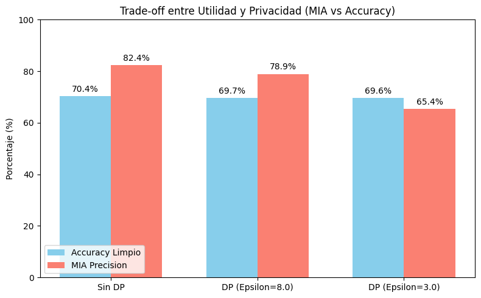

# Práctica 2. Privacidad en los Sistemas Inteligentes

**Grado en Inteligencia Artificial — Universidad de A Coruña**  
**Asignatura:** Seguridad Legal y Ética en los Sistemas Inteligentes  
**Autores:** a.serrano1@udc.es, oscar.vilela.rodriguez@udc.es, aldana.medina@udc.es  
**Grupo:** 1.8  

---

## Índice

1. [Anonimización de datos (10%)](#1-anonimización-de-datos-10)
   - 1.1 [Clasificación de atributos](#11-clasificación-de-atributos-adult-census-income)
   - 1.2 [Implementación de k-anonymity (k=3)](#12-implementación-de-k-anonymity-k3)
   - 1.3 [Ataque de Enlace (Linkage Attack)](#13-ataque-de-enlace-linkage-attack)
2. [Federated Learning (50%)](#2-federated-learning-50)
   - 2.1 [Simulación base de Federated Learning](#21-simulación-base-de-federated-learning)
   - 2.2 [Envenenamiento del Modelo (Model Poisoning)](#22-envenenamiento-del-modelo-model-poisoning)
   - 2.3 [Agregación Robusta Bizantina (Trimmed Mean)](#23-agregación-robusta-bizantina-trimmed-mean)
3. [Differential Privacy (40%)](#3-differential-privacy-40)
   - 3.1 [Ataque de Inferencia de Membresía (MIA)](#31-ataque-de-inferencia-de-membresía-mia)
   - 3.2 [Mitigación con DP-SGD (Opacus)](#32-mitigación-con-dp-sgd-opacus)
   - 3.3 [Resultados (Estudio de Ablación)](#33-resultados-estudio-de-ablación)
4. [Referencias](#4-referencias)

---
## 1. Anonimización de datos (10%)

### 1.1 Clasificación de atributos (Adult Census Income)

### Identificadores directos
El dataset Adult Census Income **no contiene identificadores directos** (nombre, DNI, email, teléfono, pasaporte). Esta es una característica habitual de datasets publicados para investigación.

### Cuasi-identificadores (QI)
Son atributos que, combinados, pueden reidentificar a un individuo al cruzarse con fuentes externas:

| Atributo | Estrategias de anonimización |
|---|---|
| `age` | Generalización por rangos (20-30, 30-40...) · Supresión de edades extremas |
| `sex` | Supresión del atributo · Generalización a categoría única |
| `native_country` | Generalización geográfica (región/continente) · Supresión de países minoritarios |
| `race` | Supresión del atributo · Generalización a categoría 'Persona' |
| `education` | Generalización por niveles (básico/medio/superior) |
| `occupation` | Generalización por sectores |

### Atributos sensibles
Información privada cuya divulgación supone el riesgo principal:
- `income` (categoría de salario: **atributo sensible principal**)
- `capital_gain`, `capital_loss`
- `occupation`

### Atributos de baja sensibilidad / estadísticos
- `fnlwgt`, `education_num`, `marital_status`, `relationship`, `hours_per_week`

---

## 1.2 Implementación de k-anonymity (k=3)

### Técnicas aplicadas por atributo

| Atributo | Técnica | Justificación |
|---|---|---|
| `age` | **Generalización** por rangos de 10 años | La edad exacta es altamente identificativa. Agruparla en intervalos (por ejemplo, `30-39`) reduce la granularidad sin perder excesiva utilidad analítica. En edades avanzadas, donde existen menos registros en el dataset, se aplicó una generalización más amplia agrupando todas las edades iguales o superiores a 70 años en la categoría `70+`, reduciendo así la granularidad del dato y favoreciendo el cumplimiento de 3-anonymity. |
| `sex` | **Supresión total** | Este atributo presenta solo dos categorías posibles y aporta escasa utilidad analítica en este ejercicio. Suprimirlo completamente reduce significativamente la capacidad de reidentificación cuando se combina con otros cuasi-identificadores. |
| `native_country` | **Generalización geográfica** | Un país concreto puede identificar individuos poco frecuentes. Agrupar los países en regiones amplias (por ejemplo, `Europe`, `America`, `Asia`) mantiene información geográfica general al tiempo que reduce el riesgo de identificación individual. |

---
**¿Es suficiente anonimizar un solo atributo?**

No. Anonimizar únicamente `age` deja combinaciones con `native_country` que forman grupos pequeños. Anonimizar únicamente `native_country` también falla (ej. `90, Asia`: 1 registro). Solo la anonimización simultánea de los tres cuasi-identificadores permite cumplir $k$-anonymity con $k=3$.

### 1.3 Ataque de Enlace (Linkage Attack)

**Explicación teórica**

Aunque un dataset cumpla formalmente la propiedad de $k$-anonymity, sigue existiendo riesgo de reidentificación cuando un atacante dispone de información auxiliar externa. En este caso, el atacante dispone de dos fuentes:

- **Dataset anonimizado:** contiene `age` (generalizado), `sex` (suprimido), `native_country` (generalizado), `income`, y otros atributos **no anonimizados** como `hours_per_week` y `education`.
- **Dataset externo** (`external_dataset.csv`): contiene `fictitious_name`, `passport_id`, `age`, `sex`, `native_country`, `hours_per_week`, `education` y `employer_or_position`.

El atacante puede cruzar ambos datasets no solo mediante los cuasi-identificadores protegidos (`age`, `sex`, `native_country`), sino también mediante los atributos compartidos que **no fueron anonimizados** (`hours_per_week`, `education`). Si tras el cruce el resultado devuelve un único registro del dataset anonimizado, el atacante puede asociar de forma inequívoca el nombre real, el número de pasaporte y la categoría salarial (`income`) de la víctima.

**Implementación y resultados**

El script de ataque aplica las mismas transformaciones de generalización a los cuasi-identificadores del dataset externo y cruza ambos datasets por las cinco columnas compartidas (`age`, `sex`, `native_country`, `hours_per_week`, `education`). Cuando el cruce devuelve un único registro, se produce la reidentificación.

Registros reidentificados unívocamente: **4 de 10 individuos**.

| Nombre | Pasaporte | Income |
|:---|:---|:---|
| Avery Kim | P730006 | <=50K |
| Casey Patel | P730003 | <=50K |
| Jordan Diaz | P730001 | >50K |
| Riley Hayes | P730005 | <=50K |

**¿Por qué falla $k$-anonymity en este escenario?**

La propiedad de $k$-anonymity solo protege los cuasi-identificadores expresamente definidos (`age`, `sex`, `native_country`). Sin embargo, el dataset anonimizado contiene otros atributos (`hours_per_week`, `education`) que **no fueron anonimizados** y que también están presentes en el dataset externo del atacante. Al combinar estos atributos adicionales con los cuasi-identificadores generalizados, el atacante consigue singularizar registros que de otro modo estarían protegidos dentro de clases de equivalencia de tamaño $k \geq 3$. Esto demuestra que $k$-anonymity es insuficiente cuando el modelo de amenaza no contempla todos los posibles cuasi-identificadores compartidos con fuentes externas.

**¿Podría haberse evitado aplicando $l$-diversity o $t$-closeness?**

Parcialmente. Tanto $l$-diversity como $t$-closeness actúan sobre la distribución del atributo sensible **dentro** de las clases de equivalencia definidas por los cuasi-identificadores protegidos. $l$-diversity forzaría al menos $l$ valores distintos de `income` dentro de cada grupo, impidiendo que un atacante que identifique el grupo deduzca el salario con certeza (ataque de homogeneidad). $t$-closeness aseguraría además que la distribución salarial del grupo se aproxime a la distribución global, evitando inferencias probabilísticas. Sin embargo, **ninguna de estas técnicas resolvería el problema fundamental** de este escenario: la existencia de atributos compartidos no protegidos (`hours_per_week`, `education`) que permiten al atacante singularizar registros más allá de las clases de equivalencia. La solución completa requiere identificar y anonimizar **todos** los posibles cuasi-identificadores que puedan estar presentes en fuentes externas.

---

## 2. Federated Learning (50%)

### 2.1 Simulación base de Federated Learning

Se particionó el subconjunto de entrenamiento de CIFAR-10 en 5 particiones disjuntas de forma independiente e idénticamente distribuida (IID) para simular 5 clientes. Se utilizó una arquitectura CNN sencilla (`SimpleCNN`) con 3 capas convolucionales (32, 64 y 64 filtros respectivamente), cada una seguida de ReLU y MaxPooling, y un clasificador totalmente conectado (1024 → 512 → 10 clases).

Se instanciaron 5 modelos locales y 1 modelo global. En cada ronda de comunicación, cada cliente sincroniza su modelo local con los pesos del modelo global, entrena localmente durante 1 época con SGD (lr=0.01, momentum=0.9) y envía los pesos resultantes al servidor. El servidor aplica **FedAvg** (McMahan et al., 2017): promedia los pesos de todos los clientes y actualiza el modelo global.

Tras 10 rondas de comunicación, el modelo global convergió adecuadamente, alcanzando un accuracy sobre el conjunto de test del **70.39%**.

### 2.2 Envenenamiento del Modelo (Model Poisoning)

Se simuló un nodo malicioso en el **Cliente 5** (índice 4), el cual aplicó dos técnicas de ataque simultáneas:

1. **Label Flipping (inversión de etiquetas):** Transforma la clase $y$ en $(y + 1) \pmod{10}$, de modo que el modelo local aprende asociaciones incorrectas.
2. **Gradient Scaling (escalamiento de pesos):** Multiplica todos los pesos de su actualización local por un factor de **100** antes de enviarlos al servidor, amplificando desproporcionadamente el impacto de la actualización maliciosa.

Al utilizar FedAvg, el promedio ponderado se ve drásticamente desplazado por los valores sobredimensionados del nodo malicioso. Como resultado, **el accuracy del modelo global se desplomó a ~10%** (equivalente a clasificación aleatoria en 10 clases), demostrando la vulnerabilidad del promediado simple frente a actualizaciones bizantinas.

### 2.3 Agregación Robusta Bizantina (Trimmed Mean)

Para mitigar el ataque de envenenamiento, se sustituyó la función de agregación FedAvg por **Trimmed Mean** (Yin et al., 2018). Esta técnica, para cada parámetro del modelo, apila los valores de todos los clientes, los ordena, descarta el 20% superior e inferior (en nuestro caso, 1 valor extremo por cada lado de 5 clientes) y promedia los 3 valores restantes.

Al repetir el entrenamiento bajo ataque con Trimmed Mean, la agregación ignoró eficazmente la actualización desproporcionada del Cliente 5 malicioso. El modelo global recuperó su convergencia, alcanzando un accuracy similar al entorno sano (~70.5%), demostrando la eficacia de la agregación robusta bizantina frente a ataques de envenenamiento.

---

## 3. Differential Privacy (40%)

### 3.1 Ataque de Inferencia de Membresía (MIA)

**¿En qué consiste y cómo funciona?**

El Membership Inference Attack (MIA) tiene como objetivo determinar si un registro específico (en este caso, una imagen de CIFAR-10) formó parte del dataset de entrenamiento de un modelo (Shokri et al., 2017). Funciona explotando el exceso de confianza (sobreajuste) que los modelos suelen exhibir sobre los datos con los que han sido entrenados en comparación con datos no vistos.

En un escenario de **caja negra** (Black-Box), el atacante solo tiene acceso a las probabilidades de salida del modelo objetivo. Entrena un clasificador binario (modelo de ataque) que recibe como entrada estas probabilidades y predice si el dato original es miembro (1) o no miembro (0) del conjunto de entrenamiento.

**Implementación**

Se utilizó el framework **Adversarial Robustness Toolbox (ART)** (Nicolae et al., 2018), instanciando un ataque `MembershipInferenceBlackBox`. El modelo de ataque se entrenó utilizando:

- **Datos miembros:** Predicciones del modelo global sobre un subconjunto de datos de entrenamiento del Cliente 1.
- **Datos no miembros:** Predicciones del modelo global sobre datos del conjunto de test.

Se evaluó el ataque calculando la **precision** (proporción de predicciones de "miembro" correctas) y el **recall** (proporción de miembros reales detectados).

### 3.2 Mitigación con DP-SGD (Opacus)

Para proteger los datos del Cliente 1 frente a la memorización, se integró la librería **Opacus** (Yousefpour et al., 2021) en el bucle de entrenamiento local, aplicando Differential Privacy Stochastic Gradient Descent (DP-SGD). DP-SGD añade dos mecanismos de protección:

1. **Recorte del gradiente (gradient clipping):** Limita la norma de cada gradiente individual a un valor máximo ($C = 1.0$), acotando la influencia de cualquier registro individual.
2. **Adición de ruido gaussiano:** Añade ruido calibrado a los gradientes agregados, garantizando privacidad diferencial formal.

Se configuró el motor de privacidad (`PrivacyEngine`) con `max_grad_norm = 1.0` y $\delta = 10^{-5}$.

**Estudio de ablación:** Se realizó el entrenamiento local variando el nivel de ruido para forzar dos presupuestos de privacidad distintos:

- **$\epsilon = 8.0$** (privacidad media): menor ruido, mayor utilidad.
- **$\epsilon = 3.0$** (alta privacidad): mayor ruido, menor utilidad.

Tras aplicar DP-SGD en el Cliente 1, se repitió el ataque MIA sobre el modelo resultante para evaluar la eficacia de la mitigación.

### 3.3 Resultados (Estudio de Ablación)

| Escenario | Accuracy Limpio | MIA Precision | MIA Recall |
| :--- | :--- | :--- | :--- |
| **Sin DP** | 70.39% | 82.35% | 21.88% |
| **DP ($\epsilon=8.0$)** | 69.71% | 78.95% | 23.44% |
| **DP ($\epsilon=3.0$)** | 69.62% | 65.38% | 26.56% |

La tabla y gráfica demuestran el trade-off entre privacidad y utilidad. Sin DP, el atacante alcanza una precision del 82.35%, indicando una capacidad significativa para distinguir miembros de no miembros. Al aplicar DP con $\epsilon = 8.0$, la precision cae al 78.95%, y con $\epsilon = 3.0$ se reduce al 65.38%. Todo ello a costa de una degradación muy pequeña del accuracy limpio (del 70.39% al 69.62%), demostrando que DP-SGD permite frustrar eficazmente el ataque MIA manteniendo la utilidad del modelo.

> *Nota sobre la reproducibilidad:* Es importante destacar que los valores exactos de precisión pueden variar ligeramente en cada ejecución del *notebook*, a pesar de tener una semilla global fijada en la configuración (`utils.py`). Esto es el comportamiento esperado: el algoritmo DP-SGD (implementado vía Opacus) inyecta ruido matemático dinámico y el entrenamiento del ataque MIA posee naturaleza estocástica. De hecho, en privacidad diferencial, la inyección de ruido debe ser impredecible por diseño para evitar vulnerabilidades de reidentificación vinculadas a generadores pseudoaleatorios deterministas.

---

## 4. Referencias

- Dwork, C., & Roth, A. (2014). *The Algorithmic Foundations of Differential Privacy*. Foundations and Trends in Theoretical Computer Science, 9(3-4), 211-407.
- Li, N., Li, T., & Venkatasubramanian, S. (2007). t-Closeness: Privacy Beyond k-Anonymity and l-Diversity. *IEEE 23rd International Conference on Data Engineering*, 106-115.
- Machanavajjhala, A., Gehrke, J., Kifer, D., & Venkitasubramaniam, M. (2006). l-Diversity: Privacy Beyond k-Anonymity. *22nd International Conference on Data Engineering (ICDE'06)*, 24-24.
- McMahan, H. B., Moore, E., Ramage, D., Hampson, S., & Arcas, B. A. (2017). Communication-Efficient Learning of Deep Networks from Decentralized Data. *Proceedings of the 20th International Conference on Artificial Intelligence and Statistics (AISTATS)*.
- Nicolae, M.-I., et al. (2018). Adversarial Robustness Toolbox v1.0.0. *arXiv:1807.01069*.
- Shokri, R., Stronati, M., Song, C., & Shmatikov, V. (2017). Membership Inference Attacks Against Machine Learning Models. *2017 IEEE Symposium on Security and Privacy*, 3-18.
- Sweeney, L. (2002). k-Anonymity: A Model for Protecting Privacy. *International Journal of Uncertainty, Fuzziness and Knowledge-Based Systems*, 10(5), 557-570.
- Yin, D., Chen, Y., Kannan, R., & Bartlett, P. (2018). Byzantine-Robust Distributed Learning: Towards Optimal Statistical Rates. *Proceedings of the 35th International Conference on Machine Learning (ICML)*.
- Yousefpour, A., et al. (2021). Opacus: User-Friendly Differential Privacy Library in PyTorch. *arXiv:2109.12298*.
